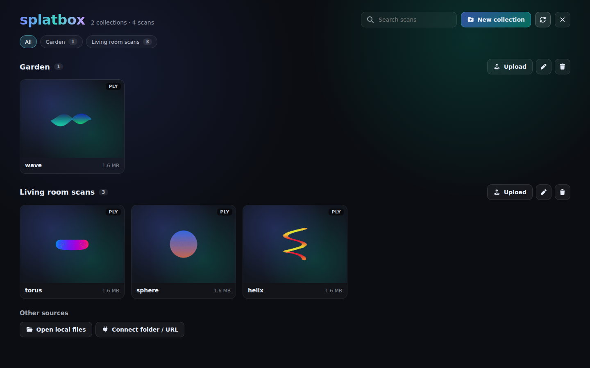
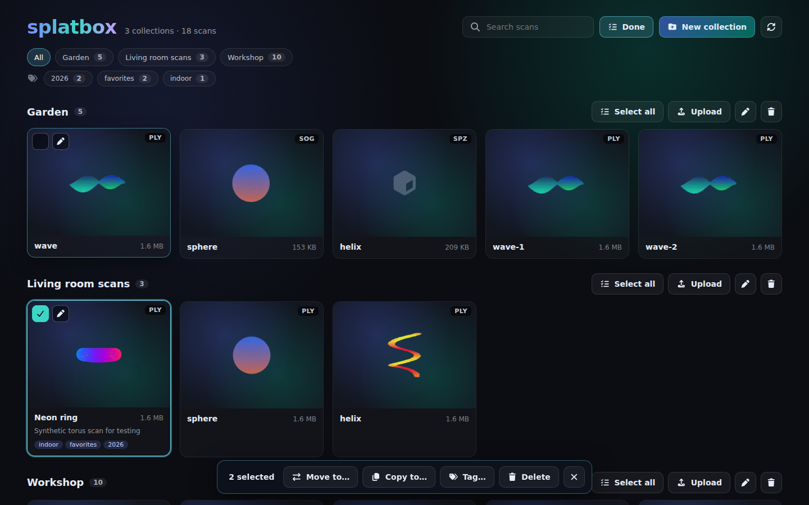
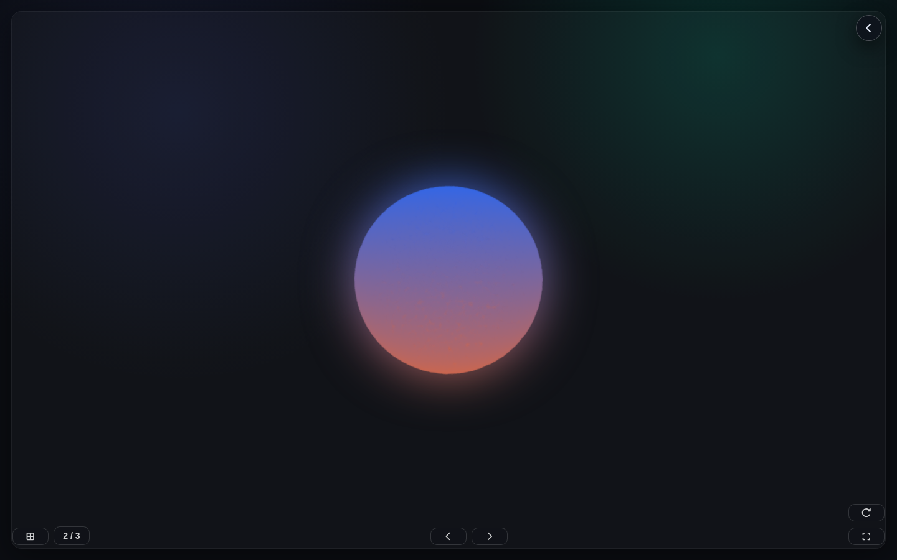
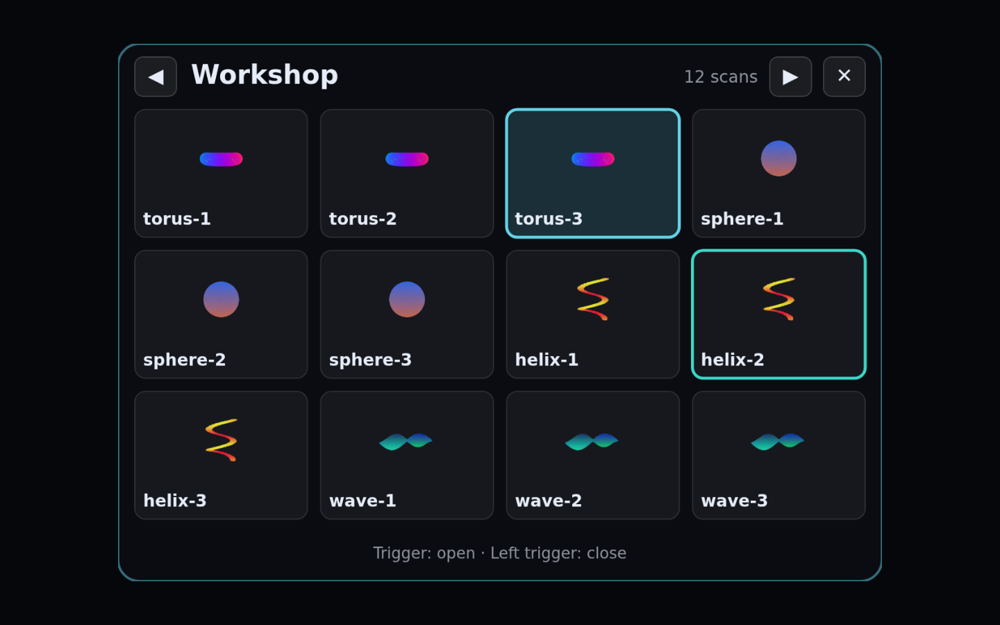

# splatbox

Self-hosted gallery and manager for Gaussian splats (`.ply`, `.sog`, `.spz`, `.splat`, `.ksplat`),
with a WebXR viewer that runs in the Quest 3 browser. One container, one `/data` volume, no external services.

- **Gallery start screen** in any browser: all collections as a grid of scans with thumbnails, search
  (name, title, description, tags), collection and tag filters, create / rename / delete collections and
  upload into them. Click a scan to open it.
- **Manage scans**: per-scan title, description and tags (pencil on a card); **Select** mode for bulk
  move / copy to another collection, tagging and delete. Thumbnails and metadata move with the scan.
- **Viewer + VR mode** (Spark 2 renderer, `.ply` / `.sog` / `.spz` / `.splat` / `.ksplat`), served by the app itself.
  The grid button (bottom left) goes back to the gallery.
- **In-VR collection browser**: a floating panel with the scans of the current collection, so you can switch
  scans (and collections) without leaving VR.
- **Thumbnails** are rendered in the browser the first time a scan is opened and stored on the server
  (`<name>.webp` next to the scan), so every device sees them.
- Per-collection `manifest.json` (manifest v1) at `/files/collections/<id>/manifest.json`.



*Gallery start screen (synthetic demo splats).*



*Select mode with titles, descriptions and tags; the bar at the bottom moves, copies, tags or deletes the selection.*



*Viewer: scan 2 of 3 in the collection, with previous/next and the gallery button.*



*The in-VR collection panel (rendered on a flat page for the screenshot).*

## Quest controls (VR)

| Input | Action |
|---|---|
| Left trigger | Open / close the collection panel |
| Trigger (either hand) while the panel is open | Click what the controller ray points at: a scan opens it, ◀ ▶ in the header switch collection, ✕ closes |
| Right thumbstick left/right (panel open) | Previous / next page |
| Grip (hold) | Grab and move / rotate the scan |
| Thumbstick up/down (panel closed) | Scale |
| Right B / A | Next / previous scan |
| Left Y / X | Scale up / down in steps |
| Thumbstick click | Right: reset view, left: reset rotation |

## Run

```bash
docker run -d -p 8080:8080 -v splatbox-data:/data ghcr.io/isabellas-agent/splatbox:edge
```

Open `http://localhost:8080`, click **New collection**, then **Upload** files into it.
WebXR only works on secure origins: terminate TLS at your ingress/proxy (the container serves plain HTTP).
Make sure the proxy allows large request bodies (uploads are streamed) and passes `Range` requests.

## Configuration (env vars)

| Variable | Default | Meaning |
|---|---|---|
| `PORT` | `8080` | HTTP port |
| `DATA_DIR` | `/data` | Collections live in `$DATA_DIR/collections/<id>/{manifest.json,assets/}` |
| `MAX_UPLOAD_GB` | `4` | Max size of one uploaded file |
| `BASIC_AUTH_USER` / `BASIC_AUTH_PASSWORD` | unset | Set **both** to require HTTP Basic auth. `/api/health` stays open |
| `BASIC_AUTH_READONLY` | `false` | With auth enabled: viewing (GET/HEAD) stays open, only writes need credentials |

## Development

```bash
cd server && npm ci && npm test           # API tests
cd web && npm ci && npm run build         # builds web/dist
cd server && DATA_DIR=../data WEB_DIR=../web/dist npm start
```

## API

`GET/POST /api/collections`, `PATCH/DELETE /api/collections/:id`,
`PUT /api/collections/:id/assets/:filename` (raw body, `application/octet-stream`),
`DELETE /api/collections/:id/assets` (`{"paths": [...]}`),
`PATCH /api/collections/:id/assets` (`{"paths": [...], "title", "description", "tags": [...], "addTags": [...], "removeTags": [...]}`),
`POST /api/collections/:id/assets/transfer` (`{"paths": [...], "target": "<collection id>", "mode": "move"|"copy"}`),
`POST /api/collections/:id/rescan?apply=1`,
`GET /api/health`.

## License

MIT
